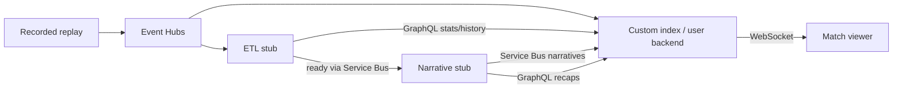

# Develop the user backend

```sh
ACCEPT_EULA=Y ./dev up backend  # build services, test APIs + actual brokers
./dev reset backend     # create a fresh Chelsea–United match run
./dev replay backend    # play the 90-minute recording in real time; optional start minute
./dev test backend      # repeat checks without resetting the active replay
```

Docker is the only prerequisite for the recorded demo. No Azure account or model key is needed. Review the [emulator licences](../../local/README.md#licences) and explicitly accept them on startup. This profile starts **Event Hubs, Service Bus, their dependencies, Postgres, the user backend, ETL stub, narrative stub and frontend**. Generating a new GRF recording has separate [native-runtime requirements](../../data-generation/docs/grf-demo.md).



## Try it

[Match viewer](http://localhost:18020/) · [Filter lab](http://localhost:18020/lab/) · [Backend API](http://localhost:18000/docs) · [ETL API](http://localhost:18010/docs) · [Narrative API](http://localhost:18011/docs)

1. Open the viewer and choose either team or Neither, plus one of four viewer styles.
2. Start the replay. Five standard-stat slots read ETL values; Insights shows authored bucket narratives unchanged.
3. Ask a match question. The agent can read standard stats, observed event history and neutral recaps, or offer a custom stat to Track.
4. Track an offered card. It replaces the lowest-priority default; Untrack restores the default.

The default fixture agent handles documented examples without a model. [Local LLM setup](local-llm.md) enables flexible questions through Microsoft Agent Framework. Unsupported recording metrics are unavailable, not invented zeros. Each recording declares its captured categories in `capabilities`; the 90-minute recording includes cards and corners but not complete body-part (header) coverage, and no recording has xG. The [filter fixtures](../fixtures/filter-lab.md) cover those capabilities in tests.

For API clients, `GET /product/profiles` lists demo identities and `POST /product/sessions` accepts `{"profile_id":"chelsea-analytical"}`. Use the returned token for `/product/{token}` and `ws://localhost:18000/product/{token}/live`. The API explorer covers audience changes, questions and offer tracking. The older `/sessions` fixture harness remains for isolated tests; it is not the match viewer's upstream path.

## Service ownership

| Owner | Current local implementation | Planned production adapter |
| --- | --- | --- |
| ETL | `etl_history` PostgreSQL raw history; `etl_stats` standard projections; GraphQL | Azure SQL history, Cosmos stat state, Event Hubs + Stream Analytics |
| Narrative | SQLite checkpoint/recap archive; authored versions per broadcast minute/bucket (92 × 12), tier recaps, key moments | Cosmos, Agent Framework generation |
| User backend | PostgreSQL `accounts` + `matchapp`; question/filter agents, cards, audience routing | Azure PostgreSQL + Container Apps |

ETL computes standard statistics; the backend never recalculates ordinary cards. Historical investigations use ETL GraphQL. Custom structured calculations run here with a shared index; equivalent requests reuse one calculation. Generated model output is validated data, never Python executed inside the API.

The narrative stub reads ETL checkpoints and the backend's enabled audience catalogue. It owns factual neutral recap tiers and their retained children. Questions read compact context first, then deeper recaps or events when needed; they never start shared narrative authoring. The manual versions are tied to the recording hash and observed evidence. See [narrative fixtures](../../narrative-engine/fixtures/README.md).

## Broker transport and state

The demo uses actual Azure SDK AMQP transports against Microsoft Event Hubs and Service Bus emulators. One shared replay producer publishes canonical events; the backend consumer commits custom calculations and its cursor together. ETL independently consumes the feed and publishes readiness, then the narrative stub sends already-framed versions through Service Bus. The backend saves a narrative inbox before acknowledgement. GraphQL remains read-only for stats/history/recaps. Broker mode rejects HTTP checkpoint writes. [Wire contracts and recovery](broker-transport.md).

Run one backend process/worker. WebSocket/session ownership is local; this setup does not prove multi-replica delivery or EPL viewer capacity. Keep loopback-only ports: demo identities are not production authentication. [Scaling boundary](scaling.md).

Refresh/reconnect within a run restores chat, selected audience and pins. A new session for the same profile takes over the previous one. `reset backend` creates a new shared run, resetting match-scoped chat/pins/calculations while preserving account profiles. `./dev down` preserves PostgreSQL and narrative volumes. The browser lab shares replay state; do not load another recording during a viewer demonstration.

`./dev` mounts the optional `.local/grf-demo-chelsea-united-90/` automatically when available; `DEMO_MEDIA_DIR` overrides that path. The backend `HlsPublisher` publishes live HLS on the replay clock; replay clips are on-demand VOD playlists. Video and events share one real-time timeline (about 94 minutes). Without the ignored media, the data demo still runs. [Frontend media setup](../../frontend/docs/development.md#optional-aligned-footage).

## Change and verify

Re-run `ACCEPT_EULA=Y ./dev up backend` after code changes; `./dev logs backend`, `./dev logs etl` and `./dev logs narrative` show service logs. `./dev test backend` runs isolated backend tests and `local/broker_check.py` plus `local/backend_broker_check.py`, which check real messaging, GraphQL, duplicates, custom calculation persistence and disabled HTTP writes without moving the active viewer replay. Older synthetic backend fixtures remain test doubles.

Run each upstream service's own tests when changing it: [ETL](../../etl/docs/development.md), [narrative](../../narrative-engine/docs/development.md). The broker integration check does not substitute for their unit/persistence tests or browser playback verification.

[Question contracts](question-agent.md) · [Testing guide](testing.md) · [Full design](../architecture.md)

Both `MATCH_EVENTHUB_CONNECTION_STRING` and `NARRATIVE_SERVICEBUS_CONNECTION_STRING` enable product broker mode. Without them, isolated tests retain HTTP doubles; the default Compose viewer supplies both.

## Event contract v3

**Implemented, unit-tested and run in the Docker stack with the 90-minute recording (`./dev test backend` broker round trip to full time).** The backend accepts the [Opta-style v3 events](../../data-generation/docs/opta-events.md): new categories, `x`/`y`, `possessionId`, `videoSeconds` and named qualifiers, up to 16 MiB and 100,000 events. Canonical events keep these as `x`, `y`, `possession_id`, `video_seconds`, `sequence` and `qualifiers`; ETL rows may omit them. Snapshot IDs exclude them, matching ETL. Custom rules cannot filter on them yet.

The clock is a broadcast clock: first-half stoppage stays in period 1 beyond 45:00, and the match can end after 90:00. Order by `(period, clock)` or `sequence`, never by clock seconds alone. A finished snapshot never rewinds to 90:00.
