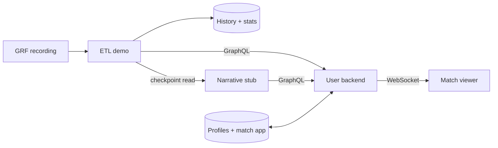

# Develop the user backend

```sh
./dev up backend        # build services, run backend tests + checkpoint check
./dev reset backend     # create a fresh Chelsea–United match run
./dev replay backend    # play the aligned 12-minute recording forward
./dev test backend      # repeat checks without resetting the active replay
```

Docker is the only prerequisite for the recorded demo. No Azure account, model key or emulator licence acceptance is needed; first run downloads images/packages. This profile starts **Postgres, the user backend, standalone ETL, the narrative stub and frontend**. Generating a new GRF recording has separate [native-runtime requirements](../../data-generation/docs/grf-demo.md).



## Try it

[Match viewer](http://localhost:18020/) · [Filter lab](http://localhost:18020/lab/) · [Backend API](http://localhost:18000/docs) · [ETL API](http://localhost:18010/docs) · [Narrative API](http://localhost:18011/docs)

1. Open the viewer and choose either team or Neither, plus one of four viewer styles.
2. Start the replay. Five standard-stat slots read ETL values; Insights shows authored bucket narratives unchanged.
3. Ask a match question. The agent can read standard stats, observed event history and neutral recaps, or offer a custom stat to Track.
4. Track an offered card. It replaces the lowest-priority default; Untrack restores the default.

The default fixture agent handles documented examples without a model. [Local LLM setup](local-llm.md) enables flexible questions through Microsoft Agent Framework. Unsupported recording metrics are unavailable, not invented zeros. This GRF recording does not identify headers, cards, corners or xG; use the separate [filter fixtures](../fixtures/filter-lab.md) when testing those capabilities.

For API clients, `GET /product/profiles` lists demo identities and `POST /product/sessions` accepts `{"profile_id":"chelsea-analytical"}`. Use the returned token for `/product/{token}` and `ws://localhost:18000/product/{token}/live`. The API explorer covers audience changes, questions and offer tracking. The older `/sessions` fixture harness remains for isolated tests; it is not the match viewer's upstream path.

## Service ownership

| Owner | Current local implementation | Planned production adapter |
| --- | --- | --- |
| ETL | `etl_history` PostgreSQL raw history; `etl_stats` standard projections; GraphQL | Azure SQL history, Cosmos stat state, Event Hubs + Stream Analytics |
| Narrative | SQLite checkpoint/recap archive; 144 authored versions, one per video minute/bucket | Cosmos, Agent Framework generation, Service Bus delivery |
| User backend | PostgreSQL `accounts` + `matchapp`; question/filter agents, cards, audience routing | Azure PostgreSQL + Container Apps |

ETL computes standard statistics; the backend never recalculates ordinary cards. Historical investigations use ETL GraphQL. Custom structured calculations run here with a shared index; equivalent requests reuse one calculation. Generated model output is validated data, never Python executed inside the API.

The narrative stub reads ETL checkpoints and the backend's enabled audience catalogue. It owns factual neutral recap tiers and their retained children. Questions read compact context first, then deeper recaps or events when needed; they never start shared narrative authoring. The 144 manual versions are tied to the recording hash and observed evidence. See [narrative fixtures](../../narrative-engine/fixtures/README.md).

## Local bridge and state

The demo uses metadata HTTP checkpoint requests and GraphQL reads across real service processes. The ETL recording endpoint supplies the shared forward replay. This is **not** production Event Hubs or Service Bus delivery. Keep the intended cloud boundary: one shared match-event consumer, separate bucket-narrative notifications and GraphQL for history/stat reads.

Run one backend process/worker. WebSocket/session ownership is local; this setup does not prove multi-replica delivery or EPL viewer capacity. Keep loopback-only ports: demo identities are not production authentication. [Scaling boundary](scaling.md).

Refresh/reconnect within a run restores chat, selected audience and pins. A new session for the same profile takes over the previous one. `reset backend` creates a new shared run, resetting match-scoped chat/pins/calculations while preserving account profiles. `./dev down` preserves PostgreSQL and narrative volumes. The browser lab shares replay state; do not load another recording during a viewer demonstration.

`./dev` mounts the optional `.local/grf-demo-chelsea-united-v2/match.mp4` automatically when available; `DEMO_VIDEO_PATH` overrides that path. Video and events share the same 12-minute timeline. Without the ignored video, the data demo still runs. [Frontend media setup](../../frontend/docs/development.md#optional-aligned-footage).

## Change and verify

Re-run `./dev up backend` after code changes; `./dev logs backend`, `./dev logs etl` and `./dev logs narrative` show service logs. `./dev test backend` runs isolated backend tests and `local/demo_check.py`, which checks real upstream history/stats/recaps at selected checkpoints without moving the active viewer replay. Older synthetic backend fixtures remain test doubles.

Run each upstream service's own tests when changing it: [ETL](../../etl/docs/development.md), [narrative](../../narrative-engine/docs/development.md). The integration checkpoint check does not substitute for their unit/persistence tests or browser playback verification.

[Question contracts](question-agent.md) · [Testing guide](testing.md) · [Full design](../architecture.md)
