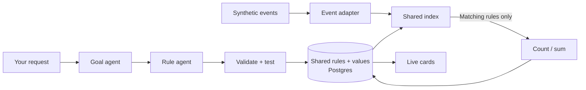

# Event filter lab

```sh
./dev up backend
```

Open **[localhost:18020](http://localhost:18020)**. Choose a preset or request a stat, add it, then start the match. New filters can also join mid-replay. **New run** clears this lab's rules and replay progress; it does not clear viewer profiles or pins. There is no video or rewind.



| Example request | Structured condition |
| --- | --- |
| Track Mbappé's headers | `player_id = mbappe AND body_part = head` |
| Chelsea corners after minute 60 | `team_id = chelsea AND event_type = corner AND match_time_seconds > 3600` |
| Mbappé's headed shots | `player_id = mbappe AND body_part = head AND event_type IN [shot, goal]` |

The [26 examples](../fixtures/filter-lab.md) use 35 synthetic deliveries, including duplicates, corrections and a retraction. “Headers” means recorded headed touches; headed attempts are a separate rule. The schema is **Opta-inspired**, not a licensed Opta integration.

## Small, replaceable pieces

| File / layer | Responsibility |
| --- | --- |
| `adapters/events.py` | Map provider keys into canonical events; swap this for a different feed. |
| `adapters/replay_source.py` | Disposable event source and observed history; exposes no future events to the UI. |
| `models/rules.py` | Validate, normalize and evaluate typed count/sum rules. |
| `services/filter_engine.py` | Share equivalent rules, index candidates, apply event deltas and corrections. |
| `agents/` + `adapters/llm.py` | Define a goal, generate a rule, validate it and allow up to three repairs. |
| `repositories/lab.py` | Store rule definitions, values, versions and replay position in Match App Postgres. |
| `services/lab.py` | Coordinate replay, persistence, planning and restore. |
| `routes/lab.py` | Validate HTTP requests and call the service. |
| `lab_factory.py` | Wire dependencies; the replacement point for a real feed. |
| `frontend/lab/` | Removable UI with separate API, controller, view and formatting modules. |

Paths in this table are relative to `backend/`, except `frontend/lab/` at the repo root.

The index uses fixed field combinations to find candidate rules. A fresh event takes at most **64 index probes**, regardless of total rule count; a correction can take 128. It still evaluates every candidate. Broad rules that all match remain expensive. Tests register **100,000 distinct filters** and assert candidate counts; this is not a production throughput claim.

Registration backfills from the already-observed event prefix once. Later events update accumulators, not full-history queries. Values and replay position commit together before the browser can read them. Restart reconstructs the index from persisted rules and the recorded prefix, then waits for Start.

## Model and production boundaries

Default mode uses documented fixture phrases. [Local LLM mode](local-llm.md) runs the goal and coding roles through a configurable model endpoint. Both paths produce the same validated JSON rules. Arbitrary Python and regex execution are not enabled; Microsoft Agent Framework integration remains future work.

This is one shared, unauthenticated development run in one backend process. The UI polls committed state every 700 ms. Per-viewer subscriptions, broker consumers, a durable delivery outbox and a coordinated ETL-history/live cutoff remain to build. The earlier profile/pin harness remains separate from this lab.

Standard stats still come from **ETL GraphQL**. The production custom-stat worker will receive shared Event Hubs events and backfill through ETL GraphQL; it does not create a publication per user or rule.

[Tests](testing.md) · [Development practices](../../DEVELOPMENT-PRACTICES.md)
