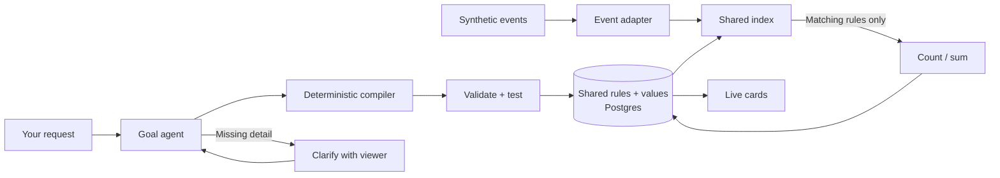

# Event filter lab

```sh
./dev up backend
```

Open **[localhost:18020](http://localhost:18020/lab/)**. Choose a preset or request a stat, add it, then start the match. The UI configures filters before replay; the API also supports late registration. **New run** clears this lab's rules and replay progress while keeping its recording. Viewer profiles and pins remain. There is no video or rewind.

## The event recording

The default is **[`fixtures/filter-lab.json`](../fixtures/filter-lab.json)**. Events are data in this file, not hardcoded in the frontend. The backend reads them in array order, translates their fields through the adapter, and sends each delivery into the shared index. Matching rules update their values; the browser polls those committed values and the received-event ledger.

**Download** saves the active recording. Edit a copy and choose **Load JSON** to validate it and start a fresh run. **Use demo** restores the repository file. Uploaded recordings are saved in the local Match App database and survive backend restarts. Each received event opens an inspector showing its original JSON and canonical fields.

Files must be UTF-8 JSON, at most **2 MiB**, with `synthetic: true`, `match_id`, two `teams`, `players`, and a nonempty `events` array. `presets` is optional. Use the default file as the format example; its event meanings are documented [here](../fixtures/filter-lab.md). Invalid uploads preserve the current run. Loading is disabled while replay or a model request is in progress. The download includes the whole recording; live inspection only exposes already-received deliveries.



| Example request | Structured condition |
| --- | --- |
| Track Mbappé's headers | `player_id = mbappe AND body_part = head` |
| Chelsea corners after minute 60 | `team_id = chelsea AND event_type = corner AND match_time_seconds > 3600` |
| Mbappé's headed shots | `player_id = mbappe AND body_part = head AND event_type IN [shot, goal]` |

The [26 examples](../fixtures/filter-lab.md) use 35 synthetic deliveries, including duplicates, corrections and a retraction. “Headers” means recorded headed touches; headed attempts are a separate rule. The schema is **Opta-inspired**, not a licensed Opta integration.

The GRF recording declares its own coverage. Native v2 distinguishes restarts taken, whistled fouls, foul victims, offsides, keeper claims and period boundaries. It can declare `body_part_event_types` for selected action categories while leaving global `body_parts` false: headed-shot filters are allowed only where coverage is declared; unsupported broad header counts remain unavailable. Raw restart/link qualifiers are preserved upstream but are not DSL fields. [Event coverage](../../data-generation/docs/event-coverage.md).

## Small, replaceable pieces

| File / layer | Responsibility |
| --- | --- |
| `adapters/events.py` | Map provider keys into canonical events; swap this for a different feed. |
| `adapters/replay_source.py` | Disposable event source and observed history; exposes no future events to the UI. |
| `models/recording.py` | Validate recording metadata, entity lists and preset rules. |
| `models/rules.py` | Validate, normalize and evaluate typed count/sum rules. |
| `services/filter_engine.py` + `time_index.py` | Share predicate families, index clock windows, apply event deltas and corrections. |
| `agents/` + `adapters/llm.py` | Interpret or clarify a goal, compile a bounded rule, validate it. |
| `repositories/lab.py` | Store rule definitions, values, versions and replay position in Match App Postgres. |
| `services/lab.py` | Coordinate replay, persistence, planning and restore. |
| `routes/lab.py` | Validate HTTP requests and call the service. |
| `lab_factory.py` | Wire dependencies; the replacement point for a real feed. |
| `frontend/lab/` | Removable UI with separate API, controller, view and formatting modules. |

Paths in this table are relative to `backend/`, except `frontend/lab/` at the repo root.

The index uses fixed field combinations to find predicate families. A fresh event takes at most **64 compound-index probes**; a correction can take 128. Identical non-clock predicates are evaluated once per family, with a clock-window index selecting matching rules. Returning changed values still costs work proportional to the number of changed rules; dense workloads remain expensive. Tests register **100,000 distinct filters** and assert candidate counts; this is not a production throughput claim.

Registration backfills from the already-observed event prefix once. Later events update accumulators, not full-history queries. Values and replay position commit together before the browser can read them. Restart reconstructs the index from persisted rules and the recorded prefix, then waits for Start.

## Model and production boundaries

Default mode uses documented fixture phrases. [Local LLM mode](local-llm.md) uses a Microsoft Agent Framework goal agent, then deterministic compilation and validation inside the SDK workflow. The optional model-based coding agent remains available for experiments; the local default needs only one successful model call per turn. Arbitrary Python and regex execution are not enabled.

**Clarifications and corrections:** a request can return a question instead of a rule. Answer in the reply box; the original request and the agent question stay in server-held context. A ready rule can also be revised before adding. New requests start fresh. Conversations expire after 15 minutes, a backend restart, recording change or New run, and allow at most three exchanges. The cache holds at most 100 conversations; it is not production chat storage.

This is one shared, unauthenticated development run in one backend process. The UI polls committed state every 700 ms. Per-viewer subscriptions, broker consumers, a durable delivery outbox and a coordinated ETL-history/live cutoff remain to build. The earlier profile/pin harness remains separate from this lab.

Standard stats still come from **ETL GraphQL**. The production custom-stat worker will receive shared Event Hubs events and backfill through ETL GraphQL; it does not create a publication per user or rule.

[Tests](testing.md) · [Development practices](../../DEVELOPMENT-PRACTICES.md)
