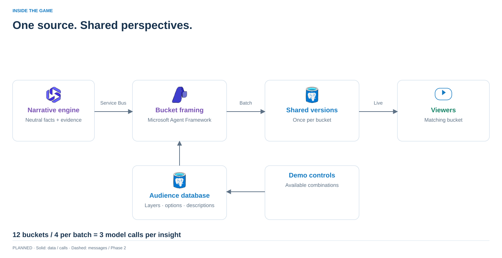

# Neutral narratives → shared audience versions



The narrative engine decides **what happened**. This backend changes **how it is explained**, once for every available bucket in the database. Viewer questions and viewer presence do not trigger generation.

## Audience data

Postgres Match App stores one validated `audience_config` JSON document, with an optimistic revision for edits:

| Part | Example |
| --- | --- |
| Layer | `team`, with a description of what this dimension means |
| Option | `home`, with a semantic description of that audience |
| Bucket | `home-simple`, selecting one option from each layer |

The [seed](../fixtures/narratives/audiences.json) has the original 12 combinations. Add layers/options and explicitly list their combinations; no uncontrolled Cartesian expansion. All enabled combinations generate, even with zero viewers. Disabled combinations are unavailable. Descriptions go into the model as data; factual grounding rules take precedence.

For a shorter hackathon run, remove/disable combinations. Set `NARRATIVE_BATCH_SIZE` to control variants per call (default **4**): 12 buckets take **3 successful calls**, 4 buckets take **1**. `NARRATIVE_MAX_VARIANTS` defaults to **48** in the local stack and rejects oversized configuration instead of silently skipping audiences. `NARRATIVE_TIMEOUT_SECONDS` defaults to **60 per batch**. `NARRATIVE_MAX_OUTPUT_TOKENS` defaults to **6000**, separately from the filter agents' token budget; some reasoning models spend this allowance on internal reasoning as well as text. Larger batches can truncate, so four remains the default. Zero enabled buckets pauses framing while preserving sources. No automatic LLM repair calls are added; a failed batch is retried on delivery, reusing completed batches.

## Try locally

```sh
./dev up backend
curl -s http://localhost:18000/audiences > /tmp/audiences.json
curl --fail http://localhost:18011/neutral-narratives \
  -H 'Content-Type: application/json' \
  --data-binary @user-backend/fixtures/narratives/neutral.json
```

The default `NARRATIVE_FRAMING_MODE=fixture` copies the neutral text into each bucket: **it tests delivery, not writing quality**. Use `NARRATIVE_FRAMING_MODE=local ./dev up backend` for the existing local development model settings. Calls use Microsoft Agent Framework through the shared model adapter. Do not commit private model configuration.

`PUT /dev/audiences` accepts `{"expected_revision":1,"config":{...}}`. `GET /audiences` returns the current revision, definitions and limits. Development configuration/ingress endpoints exist only when `ENABLE_DEV_FEED=1`; this local stack has no authentication and binds to loopback.

`PUT /sessions/TOKEN/audience` accepts `{"selections":{"team":"home","fan_style":"simple"}}`. Add the selected option for every new layer. The live snapshot's `audience` identifies the resolved bucket; `narratives` contains that bucket's versions plus their neutral sources. Existing profiles default to team/style. Adding a layer requires a selection before those viewers receive a framed version; the API reports `unconfigured` rather than guessing. Standard stat presets still use the original team/style dimensions.

The existing browser filter lab does not yet render narrative configuration or a narrative feed. Use the API explorer and `/sessions/TOKEN/live` to exercise this path.

## Upstream contract and connection

[Example version 1 message](../fixtures/narratives/neutral.json): stable `id`, `match_id`, `revision`, `minute`, neutral `text`, team-name context and evidence references. Upstream must increment `revision` to change an existing narrative. The framing model cannot set IDs, evidence or stat-selection instructions; these are owned by services.

- **Live:** `NARRATIVE_SERVICEBUS_CONNECTION_STRING` enables the async receiver for topic `narratives`, subscription `user-backend`. It renews message locks, persists variants before completion, dead-letters invalid/conflicting payloads and abandons retryable failures. Use the local emulator connection from `local/connections.env.example` (container host is `servicebus:5672`). The default stack uses a fake HTTP bridge, so it needs no broker credentials.
- **History:** the narrative service supplies `neutralNarratives(matchId, after) → {items, next_cursor}` through GraphQL. This is a proposed contract implemented by the fake service. Run `python -m backend.narrative_replay` with backend environment settings for explicit catch-up/reframing, then reconnect viewers. It never generates a neutral source.
- **Stat choices:** existing structured stat-selection delivery remains separate. New audience layers currently affect narrative wording, not the approved stat pool. Neutral text is never parsed into stat commands.

Postgres stores immutable neutral revisions, variants keyed by source revision plus bucket-description/model-policy fingerprint, and short-lived processing leases. Changing one option invalidates only affected versions; retained sources can be replayed to frame the new configuration. Old revisions are excluded from current history. This is delivery idempotency, not semantic insight deduplication; upstream still decides whether an insight should exist.

Completed batches survive restart. A crash after a model response but before persistence can repeat that call; exactly-once model execution is not claimed. One backend worker delivers sockets in the demo. Durable variants are shared, but cross-replica socket fan-out, auth and automatic GraphQL startup catch-up remain future work. History currently returns at most 200 matching items.

## Verification

`tests/test_narrative_framing.py` covers database changes, shared calls, concurrent delivery leases, revisions, partial failure recovery, routing and broker settlement. `backend.narrative_smoke` checks the running fake upstream, Postgres and WebSocket path in `./dev test backend`. Schema checks catch malformed output; they cannot prove semantic fidelity. Review real-model rewrites against their retained sources before a public demo.

[Azure Python receiver behaviour](https://learn.microsoft.com/en-us/python/api/azure-servicebus/azure.servicebus.aio.servicebusreceiver?view=azure-python) · [Development guide](development.md)

### Development checks — 18 October 2026

- Real Postgres tests cover the audience/configuration and cache paths; Docker replay exercises fake neutral ingress through to WebSocket snapshots.
- A separate real Service Bus emulator check received a source on `narratives/user-backend`, saved 12 variants and notified the viewer-delivery callback. This is local emulator verification, not an Azure deployment.
- An initial local-model sample generated 12 variants in three calls in 91.6 seconds, but added unsupported interpretation in some versions. The framing policy was tightened; this sample is not a quality pass.
- The original 3,000-token model allowance truncated revised-policy runs with both 12 and four variants per batch. Narrative framing now has a separate configurable allowance. Rewrites need a broader factuality/latency evaluation before enabling live model mode for a public demo.
- With the revised policy and 6,000-token allowance, the sample completed all 12 variants in three calls in **99.7 seconds**. Review still found unsupported intent/interpretation and an overly narrow explanation of a shot. Numeric preservation and schema validity are insufficient: real-model framing is opt-in and **not yet cleared for demo wording quality or latency**. These are individual development samples, not a benchmark or measured accuracy rate.
