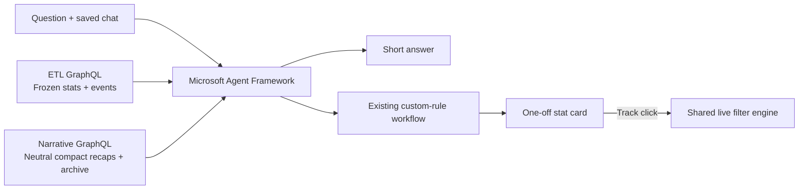

# Match questions

**Implemented local lab.** Open [Questions](http://localhost:18020), choose a demo profile and ask about the observed match or a football rule. The replay keeps running while the agent works.

## What runs

| Piece | Behaviour |
| --- | --- |
| Question agent | A narrow SDK intent call routes before numeric evidence is exposed. Statistics go to the existing planner; qualitative answers use an SDK agent with read tools. |
| Context | One frozen delivery cursor, current upstream stats, compact neutral recaps, key-event/correction ledger, recent events and 12 recent chat turns. |
| Detail tools | Read archived recap children/intervals or paginated event history through GraphQL adapters. |
| Custom statistic | Existing goal/compiler/harness; evaluate the complete observed history once. Offer a card; register a live calculation only on Track. |
| Persistence | PostgreSQL conversation, replies and stat offers per profile/run. Refresh restores them; new session takes over. |
| Fixture mode | Explicit double for listed requests; no silent replacement if the local model fails. |

The router receives catalogue meanings and recent dialogue, without stat values, events, recaps or old numeric answers. Statistical requests bypass the prose agent and retain the original conversation for clarification and scope changes. Intent classification is still probabilistic; typed routing prevents the answer model from silently doing custom arithmetic once routed, not all semantic mistakes. General football answers receive a small versioned rules reference.

The narrative engine still owns shared generation and bucket framing. Questions only read neutral recaps. Standard statistics are computed in fake ETL, never in this backend. Standard-stat answers do not create a duplicate custom calculation or offer a custom Track card.

## API

All paths below are backend paths. The lab proxies `/api/chat/*` to `/lab/chat/*`.

| Method / path | Body / result |
| --- | --- |
| `GET /lab/chat/profiles` | Demo profiles and agent mode. |
| `POST /lab/chat/sessions` | `{ "profile_id": "chelsea-analytical" }`; returns token and saved conversation. |
| `GET /lab/chat/{token}` | Saved ordered turns, offers, tracked IDs and run identity. |
| `POST /lab/chat/{token}/messages` | `{ "prompt": "How is the match going?", "request_id": "<UUID>" }`; answer, clarification or short apology. |
| `POST /lab/chat/{token}/offers/{offer_id}/track` | No rule/value from the browser; resolves the saved offer and catches up to the current observed prefix. |

Retrying a completed request UUID returns its original answer. Another pending question returns `409`; changed runs and superseded sessions cannot commit late answers or Track old offers. A process restart marks interrupted turns failed rather than leaving them permanently pending.

## Replaceable upstream connection

`adapters/question_data.py` defines `MatchDataClient` and `NarrativeClient`; `GraphQLQuestionData` sends allowlisted `questionData` queries. It checks snapshot/match identity and completeness. `services/question_snapshot.py` is the removable lab provider.

For local development only, the provider captures the delivered recording prefix and posts it to each separate fake service at `/dev/question-snapshots`. No future recording suffix is sent. The content-addressed snapshot freezes knowledge including corrections, not merely the football minute. The fake services retain at most 16 snapshots each; eviction/unavailable data fails visibly. Each snapshot accepts at most 20,000 canonical deliveries. Production needs upstream watermark/snapshot APIs instead of this development bridge.

The fake narrative builds deterministic summaries of recorded counts, with no invented tactics or possession. At 11 minute blocks it compacts the oldest five; at four five-minute blocks it combines the oldest two with the earlier-match block. Children remain in the snapshot's archive. Fetching an older snapshot retains the blocks that were active at that point. These are synthetic test summaries, not the production narrative LLM.

Recap intervals use whole-match seconds `[start,end)`. First-half stoppage can overlap the second-half football clock, so precise half-based answers must use period-tagged events/stat rules. Video, web search and playback scrubbing remain revision 2.

## Development and checks

`./dev up backend` builds the fake upstreams, API and lab. Existing ignored local model settings select fixture/local mode. `QUESTION_TIMEOUT_SECONDS` defaults to 60; the SDK/tool budget caps a question at six tool calls. `QUESTION_MAX_ACTIVE` defaults to 4 (range 1–32): excess questions fail fast instead of queueing model work, including across session takeovers. Custom planning keeps `AGENT_MAX_REPAIRS` (default 3).

- `tests/test_questions.py`: real Postgres + HTTP upstream adapters, persistence, one-off/Track, snapshot freeze, reset/takeover, retry, uploaded match IDs and timeout.
- `tests/test_question_data.py`: recap schedule/archive, corrections, pagination, identity checks and a native SDK function-tool roundtrip.
- `cd frontend && npm test`: chat restore, pending completion, stale response suppression, Track, retry IDs and safe text rendering.

The local lab is single-process and polls. Its calculation cards are shared, while offers and ownership are per profile. Connecting Track to the production profile card-priority/replacement flow remains an integration seam. There is no web search, real media, cloud deployment or arbitrary generated-code execution here.

General football explanations receive a small [offline rules reference](../backend/agents/knowledge/football-basics.json), with original summaries, source links, edition and review date. It covers common rules, not every law or competition regulation. Model classification and prose remain probabilistic: valid references and typed output do not prove every answer correct. The opt-in [conversation check](../benchmarks/README.md) requires manual review of explanations as well as numeric checks.

[Distributed deployment boundaries](scaling.md) describe what must change before adding replicas. Do not run multiple lab workers against the same state: startup recovery and in-memory calculation ownership currently assume one process.

[Readiness and remaining gates](question-readiness.md) · [Microsoft function tools](https://learn.microsoft.com/en-us/agent-framework/agents/tools/function-tools) · [Implementation plan](question-agent-plan.md)
