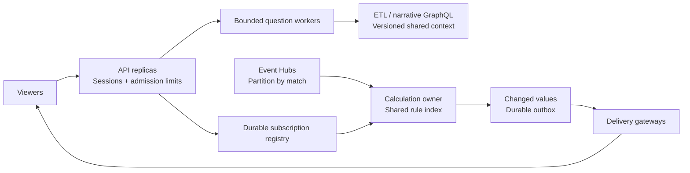

# From one match to many viewers

**Deployment design, not a measured capacity claim.** Keep the hackathon lab on one API process. Multiple copies of its in-memory replay/filter engine are not a distributed deployment, even with a shared database.

| Boundary | Distributed requirement |
|---|---|
| Match calculations | One fenced owner per match partition; event revisions, watermark and accumulator checkpoint commit together. If one match exceeds one worker, shard canonical rule IDs and broadcast that match's events to those shards. |
| Reuse | Key a calculation by match + canonical rule. Viewers subscribe to its ID. Cache one-off results by snapshot watermark + rule; singleflight identical requests. Never cache across snapshots accidentally. |
| Question workers | Per-account quotas, a bounded queue, process/provider budgets and timeouts. A viewer watching a match does not require a running agent. |
| Ownership/recovery | Durable job IDs, owner leases, expiry and fencing. A replica starting must not mark another worker's healthy jobs failed. |
| Delivery | Publish changed values once, then fan out to subscriber groups. Coalesce replaceable stat updates; replay durable narrative/history cursors after reconnect. Delivery cost remains proportional to recipients. |
| Context/storage | Upstream snapshot APIs replace the development prefix upload. Pool connections; paginate chat/history; retain match data deliberately. |

Start with shared match computations and bounded request workers. Add distributed state only when deploying replicas, rather than placing a queue around every method now. The existing adapters and repositories provide boundaries for that replacement; the local implementation does not yet supply distributed leases, outbox delivery or replica coordination.

## What to measure before claiming viewer scale

- Event rate × candidate rules, matching outputs, backfill/recovery cost and memory per unique rule.
- Question arrival rate × measured model latency/token cost; watching viewers and concurrent questions are different loads.
- Subscription count, changed-value fan-out, database latency and reconnect bursts.
- Recovery with a worker killed between event receipt, state commit and delivery; duplicate/reordered events; rolling restarts.

The [filter benchmarks](../benchmarks/README.md) measure the algorithm, not these end-to-end limits. A large shared viewer count does not imply the same number of unique rules, and a broad rule may legitimately match every event.
